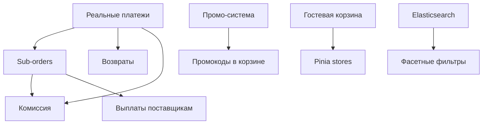

# PLANNING HANDOFF — Агент-планировщик маркетплейса Promelectron

**Дата:** 2026-05-30
**Версия:** 2.0 (после аудита)
**Цель:** Единый источник правды для агента-планировщика, который ведёт и актуализирует план разработки маркетплейса.

---

## Блок 1: Контекст проекта

> **Система агентов обновлена (2026-06-02):**  
> - `PROJECT_CONTEXT.md` — единый источник контекста для всех агентов  
> - `SESSION_START.md` — шаблон входа в сессию  
> - `scripts/kimi-task.sh` — автоматический роутер выбора агента по задаче  
> - `.agent/SESSION_LOG.md` — append-only лог изменений по сессиям  
> - Подробнее: `ROUTER.md`

### 1.1 Что это
Promelectron — маркетплейс в стиле Ozon.ru / Wildberries. Проект частично реализован, требуется доведение до production-ready состояния и дальнейшее масштабирование.

### 1.2 Текущий статус
- **Backend:** FastAPI + SQLAlchemy 2.0 async + PostgreSQL 16 + Redis 7 + MinIO + `job_worker`
- **Frontend:** Vue 3 + Vite + Axios
- **Tests:** Backend 123/123 ✅, Frontend 80/80 ✅, E2E 95/95 ✅
- **CI/CD:** GitHub Actions self-hosted runner → Harbor → K8s Helm
- **Test env:** `promelectron-test.aidrivencode.ru`
- **Готовность:** ~52% (MVP+ с гостевой корзиной и OAuth Yandex)

### 1.3 Целевая модель
Функциональность и UX на уровне Ozon.ru:
- Мульти-вендор (несколько продавцов на одной платформе)
- Гостевой режим покупки
- Реальные платежи (SBP, карты, рассрочка)
- Интеграция логистики (СДЭК, Почта)
- Промо-система и лояльность
- SEO-friendly каталог

### 1.4 Что НЕ нужно делать
- **НЕ переписывать** с нуля — работаем с существующим кодом
- **НЕ менять** стек без веских причин (FastAPI/Vue3/PostgreSQL остаются)
- **НЕ добавлять** микросервисы до Фазы 3

---

## Блок 2: Архитектура знаний

### 2.1 Категории функционала

```
┌─────────────────────────────────────────────────────────────┐
│                    ПРОЕКТ PROMEELECTRON                     │
├──────────────┬──────────────┬──────────────┬───────────────┤
│   ПОКУПАТЕЛЬ │   ПРОДАВЕЦ   │   ПЛАТФОРМА  │ ИНФРАСТРУКТУРА│
├──────────────┼──────────────┼──────────────┼───────────────┤
│ Регистрация  │ Регистрация  │ Админ-панель │ Docker/K8s    │
│ Авторизация  │ CRUD товаров │ Модерация    │ CI/CD         │
│ Каталог      │ Аналитика    │ Промо-сист.  │ Мониторинг    │
│ Корзина      │ Заказы       │ Комиссии     │ Backup        │
│ Оформление   │ Выплаты      │ Споры        │ CDN           │
│ Оплата       │ Реклама      │ SEO          │ Search        │
│ Трекинг      │              │              │               │
│ Отзывы       │              │              │               │
│ Избранное    │              │              │               │
│ Уведомления  │              │              │               │
└──────────────┴──────────────┴──────────────┴───────────────┘
```

### 2.2 Приоритеты по категориям

| Категория | Текущий % | Целевой % | Приоритет |
|-----------|-----------|-----------|-----------|
| Покупатель | 55% | 90% | P1 |
| Продавец | 50% | 85% | P1 |
| Платформа | 40% | 80% | P1-P2 |
| Инфраструктура | 55% | 90% | P0-P1 |

### 2.3 Критические gaps (топ-10)

| # | Gap | Бизнес-влияние | Техническая сложность |
|---|-----|---------------|----------------------|
| 1 | Mock-оплата (нет реального эквайринга) | Блокирует выручку | Средняя |
| 2 | Гостевая корзина | -60% конверсии | Низкая |
| 3 | Нет мониторинга/APM | Слепая зона | Низкая |
| 4 | Нет разделения заказов по поставщикам | Блокирует мульти-вендор | Высокая |
| 5 | Нет комиссии/выплат | Блокирует монетизацию | Высокая |
| 6 | Нет реальной логистики | Нет трекинга | Средняя |
| 7 | Нет промо-системы | Нет инструментов роста | Средняя |
| 8 | Workers отключены в K8s | Фоновые задачи не работают | Низкая |
| 9 | Product.price = Float | Ошибки округления | Низкая |
| 10 | Hardcoded secrets | Security риск | Низкая |

### 2.4 Зависимости между фичами



**Ключевое правило:** Нельзя начинать Sub-orders / Комиссию / Возвраты до реализации реальных платежей.

### 2.5 Технические ограничения

1. **SQLAlchemy 2.0 async** — все DB операции async, нельзя использовать sync библиотеки в основном потоке
2. **Redis single-node** — кэш и rate limit на одном инстансе
3. **Monolith** — все домены в одном FastAPI приложении
4. **JWT 30min** — нет refresh tokens, пользователи перелогиниваются
5. **PostgreSQL** — одна master БД, нет read replicas
6. **job_worker** — собственный worker с таблицей `jobs` (CDEK, email, 1C sync)
7. **Helm charts** — `job-worker` деплоится; Celery удалён

---

## Блок 3: Дорожная карта

### Фаза 1: Foundation (1-2 месяца)
**Цель:** Закрыть P0-gaps, обеспечить стабильность production

```
Неделя 1-2:  Security + Infrastructure
  ├── Убрать hardcoded secrets
  ├── Убрать Alembic из lifespan
  ├── Исправить Helm worker templates
  ├── Подключить Sentry
  └── Настроить backup БД

Неделя 3-4:  Платежи (критично!)
  ├── Интеграция ЮKassa (подробный план: `.agent/tasks/TASK_YOOKASSA_PLAN.md`)
  │   ├── Phase 1: SDK + конфиг + env vars + Alembic миграция Payment
  │   ├── Phase 2: YooKassaService (create/get payment) + обновить create_payment endpoint
  │   ├── Phase 3: Webhook endpoint (succeeded/canceled) + проверка подписи
  │   ├── Phase 4: Frontend редирект на confirmation_url + success page
  │   └── Phase 5: Backend тесты + E2E тест с тестовой картой
  ├── Webhook обработка
  ├── Тестовые платежи
  └── Обновить checkout flow

Неделя 5-6:  Гостевая корзина
  ├── localStorage cart
  ├── Merge при авторизации
  └── Pinia foundation

Неделя 7-8:  Polish
  ├── Product.price → Numeric
  ├── Distributed rate limiting
  ├── PodSecurityContext
  └── Performance baseline
```

**Критерий завершения:** Реальные платежи работают, гостевая корзина в проде, нет критичных security issues.

### Фаза 2: Core-функционал (2-4 месяца)
**Цель:** Достичь функциональности среднего маркетплейса

```
Месяц 1:  Заказы + Логистика
  ├── Sub-orders (разделение по поставщикам)
  ├── Комиссионная система
  ├── Интеграция СДЭК / Почта
  └── Расчёт стоимости доставки

Месяц 2:  Промо + Search
  ├── Промо-система (купоны, акции)
  ├── Full-text search (PostgreSQL tsvector)
  ├── Фасетные фильтры
  └── Баннеры в админке

Месяц 3:  Seller Experience
  ├── Self-service onboarding
  ├── Product variants (size/color)
  ├── Bulk CSV import
  └── Seller payouts UI

Месяц 4:  Frontend + Platform
  ├── Pinia полный переход
  ├── Lazy loading
  ├── Модерация товаров/отзывов
  └── Возвраты и возмещения
```

**Критерий завершения:** Мульти-вендор работает, продавцы получают выплаты, поиск с фильтрами, промо активна.

### Фаза 3: Scale (4-8 месяцев)
**Цель:** Конкурентоспособность с Ozon/Wildberries

```
Месяц 1-2:  Search + SEO
  ├── Elasticsearch
  ├── SSR / SSG
  ├── Sitemap + микроразметка
  └── CDN

Месяц 3-4:  ML + Mobile
  ├── Рекомендательная система
  ├── Mobile app MVP
  └── A/B тестирование

Месяц 5-6:  Architecture
  ├── Extract Notification Service
  ├── Extract Payment Service
  └── Event sourcing для заказов

Месяц 7-8:  International
  ├── i18n
  ├── Multi-currency
  └── Multi-region deployment
```

**Критерий завершения:** SEO-трафик растёт, mobile app в сторах, рекомендации работают.

---

## Блок 4: Правила ведения плана

### 4.1 Как обновлять план

1. **После каждого спринта** (2 недели):
   - Обнови статус задач (Done / In Progress / Blocked)
   - Пересчитай % готовности по блокам
   - Зафиксируй новые блокеры

2. **При появлении новых требований**:
   - Оцени бизнес-влияние (Revenue / Conversion / Retention / Operational)
   - Проверь зависимости — что блокирует новую фичу
   - Оцени усилие (S/M/L/XL)
   - Если P0 — вставь в текущий спринт, вытеснив низший приоритет
   - Если P1 — добавь в следующий спринт
   - Если P2 — добавь в бэклог Фазы 2 или 3

3. **При изменении сроков**:
   - Пересчитай критический путь (зависимости)
   - Уведоми stakeholder'ов о сдвиге
   - Предложи scope reduction (урезание функциональности) как альтернативу сдвигу сроков

4. **Как фиксировать выполненное**:
   - Ставь галочку в AUDIT.md
   - Обновляй CHANGELOG
   - Веди `docs/ROADMAP.md` с актуальным статусом

### 4.2 Формат задачи для разработчиков

Каждая задача должна содержать:

```markdown
### [P0/P1/P2] Название задачи

**Контекст:** 2-3 предложения о том, зачем это нужно

**Что сделать:**
- [ ] Конкретное действие 1
- [ ] Конкретное действие 2

**Технические детали:**
- Файлы: `backend/src/app/...`
- Модели: `Order`, `Product`
- API: `POST /api/v1/...`

**Зависимости:**
- Блокируется: задача X
- Блокирует: задача Y

**Критерии приёмки:**
1. Тесты проходят (backend + frontend)
2. E2E сценарий работает
3. Документация обновлена (если API меняется)

**Оценка:** S/M/L/XL
**Риски:** ...
```

### 4.3 Приоритизация

| Приоритет | Когда использовать | Примеры |
|-----------|-------------------|---------|
| **P0** | Блокирует запуск, безопасность, юридические требования | Платежи, гостевая корзина, backup |
| **P1** | Блокирует рост, конкурентное преимущество | Sub-orders, комиссия, логистика, промо |
| **P2** | Улучшение UX, оптимизация, масштабирование | SSR, мобильное приложение, ML |
| **P3** | Техдолг, рефакторинг | Разделение OrderService, внедрение Pinia |

### 4.4 Scope management

**Golden rule:** Новая фича = новая задача = оценка + приоритет. Не добавляй в спринт без оценки.

**Если stakeholder просит "сделать быстро"**:
1. Спроси: "Что вытеснить из текущего спринта?"
2. Предложи MVP-версию фичи (80/20)
3. Зафиксируй технический долг (доработать позже)

---

## Блок 5: Формат взаимодействия

### 5.1 Как отдавать задачи разработчикам

1. **Backend-dev agent:**
   - API endpoints, models, services, migrations
   - Требование: pytest 102/102 должны проходить
   - Alembic миграции отдельным коммитом

2. **Frontend-dev agent:**
   - Vue components, composables, router
   - Требование: vitest 77/77 + E2E 95/95
   - Использовать `data-testid` для E2E

3. **Devops agent:**
   - Dockerfile, Helm, CI/CD, monitoring
   - Требование: `helm upgrade --install` проходит успешно
   - Не трогать `.github/` без явного разрешения

4. **E2E-tester agent:**
   - Playwright тесты
   - Требование: прогон на `promelectron-test.aidrivencode.ru`

### 5.2 Как фиксировать прогресс

| Метрика | Как считать | Цель |
|---------|------------|------|
| **% готовности блока** | Кол-во готовых фич / всего фич в блоке | 50% → 90% за 6 мес |
| **Lead time** | Время от создания задачи до merge в main | < 5 дней для P0, < 10 дней для P1 |
| **Test coverage** | `pytest --cov` + vitest coverage | Backend > 80%, Frontend > 70% |
| **Uptime** | K8s pod availability | > 99.5% |
| **Blockers** | Количество задач со статусом Blocked | 0 P0-blockers |

### 5.3 Еженедельный ритм

```
Понедельник:
  ├── Обзор прошлой недели (что сделано)
  ├── Обновление метрик
  └── Планирование текущей недели

Среда:
  └── Mid-week check: есть ли blockers?

Пятница:
  ├── Демо готовых фич
  ├── Обновление ROADMAP.md
  └── Ретроспектива (что пошло не так)
```

### 5.4 Репозиторий артефактов

| Артефакт | Локация | Обновляет | Частота |
|----------|---------|-----------|---------|
| AUDIT.md | `/AUDIT.md` | Агент-аудитор | Раз в квартал |
| PLANNING_HANDOFF.md | `.agent/PLANNING_HANDOFF.md` | project-manager | По мере изменений |
| BACKLOG.md | `.agent/BACKLOG.md` | project-manager | Каждый спринт |
| BLOCKERS.md | `.agent/BLOCKERS.md` | project-manager + все агенты | Ежедневно |
| METRICS.md | `.agent/METRICS.md` | project-manager | Каждую пятницу |
| DECISIONS.md | `.agent/DECISIONS.md` | project-manager | По каждому ADR |
| AGENTS.md | `AGENTS.md` | project-manager | По изменению ролей |
| ROADMAP.md | `docs/ROADMAP.md` | project-manager | Каждый спринт |
| CHANGELOG.md | `CHANGELOG.md` | project-manager | Каждый релиз |

---

## Дополнение A: Приоритизация гостевого режима

Гостевой режим — **P0-приоритет**, т.к. блокирует конверсию.

| Фича | Приоритет | Почему | Блокирует |
|------|-----------|--------|-----------|
| Гостевая корзина | P0 | 60-70% пользователей бросают корзину при принудительной регистрации | Checkout, оплата |
| Guest checkout | P0 | Без него гостевая корзина бесполезна | Платежи |
| Merge cart при login | P0 | Данные не должны теряться | Гостевая корзина |
| Избранное для гостей | P1 | Влияет на возврат пользователя | — |
| Недавно просмотренные | P1 | Данные для рекомендаций | — |
| Уведомления о цене | P2 | Удержание, но не критично для MVP | — |

---

## Дополнение B: Правило при блокере

1. **Зафиксировать** в `.agent/BLOCKERS.md` в течение 1 часа
2. **Пересчитать** критический путь — какие задачи затронуты
3. **>2 дней** — эскалировать пользователю с планом B
4. **>5 дней** — emergency standup всех агентов, возможно снижение scope

---

## Дополнение C: Формат запроса помощи другому агенту

1. Создать задачу в `.agent/BACKLOG.md` в секции "Запросы помощи"
2. Указать:
   - **Кто запрашивает:** агент
   - **Что нужно:** конкретное действие
   - **Зачем:** бизнес-контекст
   - **Критичность:** P0/P1/P2
   - **Желаемый срок:** дата
3. project-manager приоритизирует и назначает исполнителя в течение 4 часов

---

## Блок 6: Чеклист для агента-планировщика

При получении нового запроса от пользователя:

- [ ] Определить категорию (Покупатель / Продавец / Платформа / Инфраструктура)
- [ ] Проверить зависимости — что блокирует эту фичу
- [ ] Оценить усилие (S/M/L/XL) и бизнес-влияние
- [ ] Присвоить приоритет (P0/P1/P2/P3)
- [ ] Обновить ROADMAP.md
- [ ] Создать задачу в нужном формате
- [ ] Назначить ответственного агента (backend-dev / frontend-dev / devops)
- [ ] Установить критерии приёмки
- [ ] Обновить метрики (% готовности)

---

## Блок 7: Контакты и ресурсы

- **Test env:** `https://promelectron-test.aidrivencode.ru`
- **GitHub:** `github.com/AutonomaCo/promelectron`
- **CI/CD:** GitHub Actions → Harbor → K8s
- **Docs:** `ARCHITECTURE.md` (общая архитектура)
- **AGENTS.md:** `AGENTS.md` — индекс агентов, skills, rules

---

**Этот документ — живой.** Обновляй при каждом значимом изменении плана.
