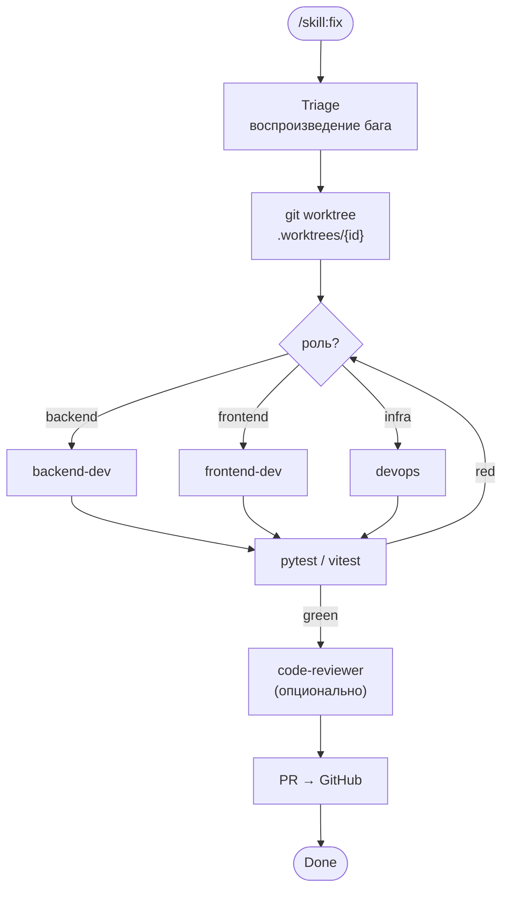

# /skill:flow-fix — Визуализатор пайплайна fix

> **ЯЗЫК / LANGUAGE:** Следуй [Rule: Agent Commons](../../rules/agent-commons.md) > Language Rule / Языковое правило.

Покажи пользователю, **на какой фазе пайплайна `/skill:fix` находится багфикс**, в виде компактной Mermaid-диаграммы с подсветкой плюс следующее действие.

Это **read-only** скилл: ничего не редактируй, не запускай тесты, не двигай GitHub Project board.

---

## Step 0: Определение task-id

Аргумент или текущая ветка `bugfix/<task-id>` / `feature/<task-id>`:

```bash
git branch --show-current
ls .agent/runs/
```

`task-id` должен соответствовать `^[a-z0-9-]+$`. Если определить нельзя — перечисли задачи и спроси.

---

## Step 1: Сбор состояния

```bash
AGENT_DIR=".agent/runs/<task-id>"
ls "$AGENT_DIR" "$AGENT_DIR/review" 2>/dev/null
grep -o "TESTS_PASSED\|TESTS_FAILED" "$AGENT_DIR/review/test-findings.md" 2>/dev/null | tail -1
git worktree list | grep "<task-id>"
gh pr view --json state,url 2>/dev/null
```

---

## Step 2: Определение текущей фазы

| Фаза | Признак |
|------|---------|
| `Done` | PR `MERGED` |
| `PR` | PR `OPEN` |
| `Review` | `review/findings.md` существует |
| `Tests` | существует worktree и есть коммиты в ветке, но findings нет |
| `Dev` | существует `.worktrees/<task-id>/` или ветка, но нет коммитов |
| `Triage` | есть только `.agent/runs/<task-id>/task.md` |

---

## Step 3: Рендер диаграммы

Выведи эту диаграмму в блоке ```` ```mermaid ````, добавив `style`-подсветку (текущая фаза — жёлтая с толстой рамкой, пройденные — зелёные):



Соответствие фаз узлам: `Triage` → `Triage`, `Dev` → `Role` + узел выбранной роли, `Tests` → `Tests`, `Review` → `Review`, `PR` → `PR`, `Done` → `Done`. `Worktree` подсвечивай пройденным, если worktree/ветка существуют.

Формат подсветки:

```text
style <Node> fill:#ffe082,stroke:#f57f17,stroke-width:4px   %% текущая
style <Node> fill:#c8e6c9,stroke:#2e7d32,stroke-width:3px   %% пройденная
```

---

## Step 4: Отчёт и следующее действие

- **Задача:** `<task-id>` · ветка
- **Текущая фаза:** `<Фаза>` — одно предложение
- **Открытые замечания:** `OPEN` в findings.md (если есть)
- **Следующий шаг:**
  - Triage → `/skill:fix "<описание бага>"`
  - Dev → продолжить `/skill:fix <task-id>`
  - Tests → запустить тесты / `/skill:qa-gate <task-id>`
  - Review → исправить findings, затем `/skill:review`
  - PR → `/skill:ship`
  - Done → `/skill:context-sync`

---

## Правила

- **Read-only:** не редактируй файлы, не запускай субагентов, тесты и `make`.
- Не двигай GitHub Project board.
- Если задача не найдена — скажи прямо и предложи `/skill:fix "<описание>"`.
