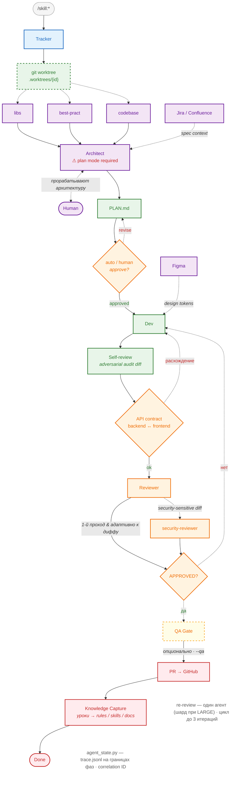

# /skill:flow-implement — Визуализатор пайплайна implement

> **ЯЗЫК / LANGUAGE:** Пользователь общается на русском. Все ответы пользователю и артефакты пиши на русском. Стремись рассуждать на русском, но если reasoning уходит на английский — это не ошибка. Код, команды, идентификаторы, пути и технические термины оставляй в оригинале.

Покажи пользователю, **на какой фазе пайплайна `/skill:implement` находится задача**, в виде Mermaid-диаграммы с подсветкой (Mermaid рендерится в web chat Kimi Code) плюс краткий статус и следующее действие.

Это **read-only** скилл: ничего не редактируй, не запускай тесты, не двигай GitHub Project board.

---

## Step 0: Определение task-id

Если `task-id` передан аргументом — используй его. Иначе выведи из текущей ветки:

```bash
git branch --show-current   # feature/<task-id> или bugfix/<task-id>
```

Если ветка `main` и аргумент не передан — перечисли доступные задачи и спроси, какую показать:

```bash
ls .agent/runs/
```

`task-id` должен соответствовать `^[a-z0-9-]+$`. Иначе — остановись и попроси корректный id.

---

## Step 1: Сбор состояния

Используй единый источник истины — `scripts/agent_state.py`:

```bash
python3 scripts/agent_state.py state <task-id>
```

Он вернёт JSON: `phase`, `artifacts`, `branch`, `worktree_exists`, `findings` (total/open/fixed/verified/approved), `tests_status`, `pr_state`, `pr_url`. Флаг `--no-pr` — если gh недоступен/офлайн.

Не падай, если артефактов нет — отсутствие артефакта это тоже сигнал фазы.

---

## Step 2: Определение текущей фазы

Фазу возвращает `agent_state.py` (поле `phase`). Логика детекции (справочно, не дублируй её парсингом):

| Фаза | Признак |
|------|---------|
| `done` | PR существует и `state == MERGED` |
| `mr` | PR открыт (`OPEN`), либо `test-findings.md` содержит `TESTS_PASSED` |
| `qa_gate` | `findings.md` содержит верхнеуровневый `APPROVED`, но `test-findings.md` нет или `TESTS_FAILED` |
| `reviewer` | `review/findings.md` существует, нет `APPROVED` |
| `dev` | `spec.md` существует, `review/findings.md` нет |
| `architect` | `task.md` существует, `spec.md` нет |
| `tracker` | `.agent/runs/<task-id>/` не существует (только ветка или вообще ничего) |

Пройденные фазы — все фазы левее текущей в цепочке `tracker → architect → dev → reviewer → qa_gate → mr → done`.

---

## Step 3: Рендер диаграммы

Выведи пользователю в блоке ```` ```mermaid ```` встроенный шаблон пайплайна (ниже), добавив в конец (после строк `class ...`) подсветку:

- Текущая фаза:
  ```text
  style <Node> fill:#ffe082,stroke:#f57f17,stroke-width:4px
  ```
- Каждая пройденная фаза:
  ```text
  style <Node> fill:#c8e6c9,stroke:#2e7d32,stroke-width:3px
  ```

Шаблон диаграммы (источник истины для чат-вывода; каноническая диаграмма документации — `docs/08-ai-agent-pipeline.drawio`, рендер `docs/08-ai-agent-pipeline.svg`):



Имена узлов: `Tracker`, `Worktree`, `Architect`, `Dev`, `Reviewer`, `Approved`, `QA_Gate`, `MR`, `Done`. Маппинг фазы на узел: `tracker` → `Tracker`, `architect` → `Architect`, `dev` → `Dev`, `reviewer` → `Reviewer`, `qa_gate` → `QA_Gate`, `mr` → `MR`, `done` → `Done`. Узел `Worktree` подсвечивай как пройденный, если существует `.worktrees/<task-id>/` или ветка `feature|bugfix/<task-id>`.

Не перерисовывай диаграмму от себя — используй шаблон выше как источник истины, только добавляй `style`-строки.

---

## Step 4: Отчёт и следующее действие

Кратко, на русском:

- **Задача:** `<task-id>` · ветка `feature/<task-id>` (если есть)
- **Текущая фаза:** `<phase>` — одно предложение, что там происходит
- **Артефакты:** список из поля `artifacts`
- **Открытые замечания:** `findings.open` из state JSON и `[H-xxx]` из findings.md (если есть)
- **Следующий шаг:** одна конкретная команда, например:
  - `tracker` → `/skill:implement "<описание>"` или завести GitHub Issue
  - `architect` → ждать одобрения spec, затем продолжить `/skill:implement <task-id>`
  - `dev` → дождаться developer'ов или `/skill:implement <task-id>` продолжить
  - `reviewer` → developer правит findings, затем `/skill:review`
  - `qa_gate` → `/skill:qa-gate <task-id>`
  - `mr` → `/skill:ship` или review PR на GitHub
  - `done` → задача закрыта; `/skill:context-sync`

---

## Правила

- **Read-only:** не редактируй файлы, не запускай субагентов, тесты и `make`.
- Не двигай GitHub Project board и не комментируй PR.
- Диаграмма для чат-вывода всегда строится из встроенного шаблона (Step 3); каноническая документационная версия — `docs/08-ai-agent-pipeline.drawio` (генератор `scripts/docs/gen_diagrams.py`).
- Если `.agent/runs/<task-id>/` нет и ветки нет — скажи прямо, что задача не заведена, и предложи `/skill:implement`.
