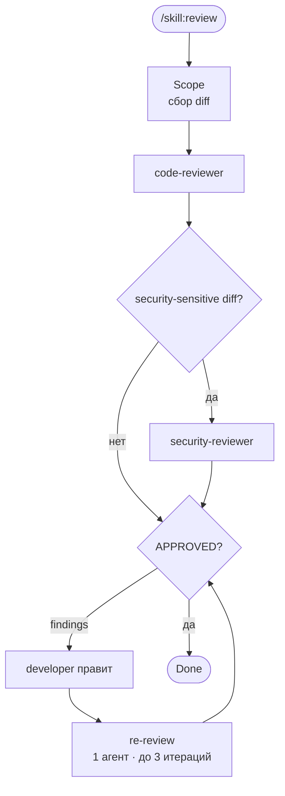

# /skill:flow-review — Визуализатор review-цикла

> **ЯЗЫК / LANGUAGE:** Пользователь общается на русском. Все ответы пользователю и артефакты пиши на русском. Стремись рассуждать на русском, но если reasoning уходит на английский — это не ошибка. Код, команды, идентификаторы, пути и технические термины оставляй в оригинале.

Покажи пользователю **состояние review-цикла** для задачи: сколько итераций прошло, какие findings открыты, кто сейчас должен действовать — в виде Mermaid-диаграммы с подсветкой.

Это **read-only** скилл: ничего не редактируй, не запускай субагентов, не двигай GitHub Project board.

---

## Step 0: Определение task-id

Аргумент или текущая ветка `feature/<task-id>` / `bugfix/<task-id>`:

```bash
git branch --show-current
ls .agent/runs/
```

`task-id` должен соответствовать `^[a-z0-9-]+$`. Если определить нельзя — перечисли задачи и спроси.

---

## Step 1: Сбор состояния

```bash
AGENT_DIR=".agent/runs/<task-id>"
FINDINGS="$AGENT_DIR/review/findings.md"
ls "$AGENT_DIR/review" 2>/dev/null
grep -c "^### \[" "$FINDINGS" 2>/dev/null                       # всего findings
grep -c "Status:\*\* OPEN" "$FINDINGS" 2>/dev/null             # открытых
grep -cE "Status:\*\* (FIXED|RESOLVED)" "$FINDINGS" 2>/dev/null  # исправленных, ждут re-review
grep -c "Status:\*\* VERIFIED" "$FINDINGS" 2>/dev/null         # закрытых
head -20 "$FINDINGS" 2>/dev/null | grep -o "FIXES_NEEDED\|APPROVED" | tail -1  # верхнеуровневый вердикт
grep -c "^## Iteration" "$FINDINGS" 2>/dev/null                # итерации ревью
```

Если `findings.md` нет — review-цикл ещё не запускался: покажи диаграмму с текущей фазой `Scope` и предложи `/skill:review`.

---

## Step 2: Определение текущей фазы

| Фаза | Признак |
|------|---------|
| `Done` | верхнеуровневый вердикт `APPROVED` и нет `OPEN` findings |
| `Fix` | есть findings со статусом `OPEN` (developer должен править) |
| `Review` | `OPEN` нет, но есть `FIXED`/`RESOLVED` без `VERIFIED`, или вердикт `FIXES_NEEDED` (нужен re-review) |
| `Scope` | `findings.md` отсутствует |

Помни жёсткий лимит: **максимум 3 итерации** review-цикла. Если итераций уже 3 и findings ещё открыты — подсвети это в отчёте и предложи эскалацию к пользователю.

---

## Step 3: Рендер диаграммы

Выведи эту диаграмму в блоке ```` ```mermaid ````, добавив `style`-подсветку (текущая фаза — жёлтая с толстой рамкой, пройденные — зелёные):



Соответствие фаз узлам: `Scope` → `Scope`, `Review` → `Re`, `Fix` → `Fix`, `Done` → `Done`. `CR` подсвечивай пройденным, если findings.md существует; `SR` — если в findings.md есть замечания с префиксом `[S-`.

Формат подсветки:

```text
style <Node> fill:#ffe082,stroke:#f57f17,stroke-width:4px   %% текущая
style <Node> fill:#c8e6c9,stroke:#2e7d32,stroke-width:3px   %% пройденная
```

---

## Step 4: Отчёт и следующее действие

- **Задача:** `<task-id>` · ветка
- **Итерация:** N из 3
- **Findings:** X открытых / Y исправленных / Z всего (с разбивкой `[F-` code vs `[S-` security, если видно)
- **`[H-xxx]`:** список открытых human-decision пунктов (если есть)
- **Текущая фаза:** `<Фаза>` — кто должен действовать
- **Следующий шаг:**
  - Scope → `/skill:review`
  - Fix → developer исправляет `OPEN` findings
  - Review → `/skill:review` (re-review)
  - Done → `/skill:qa-gate <task-id>` или `/skill:ship`
  - 3 итерации и не APPROVED → эскалация: разобрать оставшиеся findings с пользователем

---

## Правила

- **Read-only:** не редактируй файлы, не запускай субагентов и тесты.
- Не двигай GitHub Project board и не комментируй PR.
- Считай findings только из `.agent/runs/<task-id>/review/findings.md`; не выдумывай статусы.
