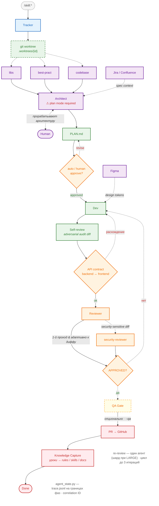

# Promelectron

Интернет-магазин электротоваров на **FastAPI + Vue 3** с CI/CD через GitHub Actions → Harbor → Kubernetes.

## Стек

- **Backend:** Python 3.12, FastAPI, SQLAlchemy 2.0 (async), PostgreSQL 16, Redis 7
- **Frontend:** Vue 3 (Composition API), Vite, Vue Router, Axios
- **Тесты:** pytest (backend), Vitest (frontend), Playwright (e2e)
- **База данных:** PostgreSQL, миграции через Alembic
- **Инфраструктура:** Docker Compose (local), Kubernetes + Helm (prod/test), Harbor (registry)
- **CI/CD:** GitHub Actions (self-hosted runner)

## Быстрый старт

```bash
# 1. Скопировать env
cp backend/.env.example backend/.env
# Отредактировать backend/.env при необходимости

# 2. Запустить всё
make dev

# 3. Наполнить тестовыми данными
make seed

# 4. Открыть приложение
# Frontend: http://localhost:5173
# API:       http://localhost:8000
# Docs:      http://localhost:8000/docs
```

## Команды (Makefile)

```bash
make dev              # Запуск backend + frontend + PostgreSQL + Redis
make stop             # Остановка dev-окружения
make seed             # Сид тестовых данных (admin, supplier, категории, товары)
make migrate          # Alembic upgrade head (через Docker)
make test             # Все тесты (pytest + vitest + e2e)
make test-backend     # pytest
make test-frontend    # Vitest
make test-e2e         # Playwright через Docker
```

## Структура проекта

```
backend/              — Бэкенд FastAPI
  src/app/
    api/              — REST эндпоинты
    models/           — SQLAlchemy ORM
    schemas/          — Pydantic схемы
    services/         — Бизнес-логика
  alembic/            — Миграции БД
  seed_data.py        — Сид тестовых данных
frontend/             — Фронтенд Vue 3
  src/
    views/            — Страницы
    components/       — Компоненты
    composables/      — Логика (useAuth и др.)
    router/           — Vue Router
    services/         — Axios API клиент
  e2e/                — Playwright E2E тесты
infra/helm/           — Helm чарты для Kubernetes
.github/workflows/    — CI/CD пайплайны
```

## API

Базовый URL: `http://localhost:8000/api/v1`

- `POST /register` — Регистрация
- `POST /login` — Логин
- `GET /products/` — Список товаров
- `GET /products/{id}` — Товар по ID
- `POST /cart/add` — Добавить в корзину
- `POST /orders/create` — Оформить заказ
- `GET /categories/` — Список категорий
- `GET /admin/dashboard` — Админ-дашборд (требует admin)
- ... (полный список в документации)

## Документация API

При запущенном бэкенде:
- Swagger UI: `http://localhost:8000/docs`
- ReDoc: `http://localhost:8000/redoc`

## Окружения

| Окружение | URL | API |
|-----------|-----|-----|
| Local | http://localhost:5173 | http://localhost:8000 |
| Test | https://promelectron-test.aidrivencode.ru | https://api.promelectron-test.aidrivencode.ru |
| Prod | manual deploy | manual deploy |

## CI/CD Pipeline

```
push to main
    ↓
Build (Docker images) → Harbor
    ↓
Deploy to Test (K8s)
    ↓
Smoke tests (API + Frontend health)
    ↓
E2E tests (Playwright, 4 workers)
    ↓
Manual approval → Deploy to Prod
```

## AI Agent Pipeline

Проект использует мульти-агентный pipeline на базе **Kimi Code CLI**.  
Каждая задача проходит через изолированный git worktree, ролевых агентов, code review и QA gate.

> Источник диаграммы: [`docs/ai-agent-pipeline.mmd`](docs/ai-agent-pipeline.mmd)



Entry-скиллы:
- `/skill:implement` / `/skill:fix` → **Tracker**
- `/skill:spec` → **Architect**
- `/skill:review` → **Reviewer**
- `/skill:qa-gate` → **QA Gate**
- `/skill:ship` → **PR → GitHub**
- `/skill:flow-implement` / `/skill:flow-fix` / `/skill:flow-review` → **read-only статус** задачи (диаграмма с подсветкой текущей фазы)

Кубики пайплайна:

| Кубик | Роль | Что делает |
|-------|------|------------|
| Tracker | — | Определяет роль и маршрут задачи |
| Architect | `architect` | Пишет техническую спецификацию в plan mode |
| Research | `explore` subagents | Параллельный research: libraries, best-practices, codebase |
| Backend Dev | `backend-dev` | Модель → схема → сервис → эндпоинт → тесты |
| Frontend Dev | `frontend-dev` | API client → composable → компонент → страница → тесты |
| Plan | dev-роли | Пишет `$WORKTREE/PLAN.md` перед кодированием |
| Approve | оркестратор | Auto-одобрение простых планов / human-одобрение сложных |
| Self-review | dev-роли | Adversarial audit своего diff (3–5 проблем) до ревью |
| API Contract | оркестратор | Сверка backend ↔ frontend контракта до ревью (Step 5.5) |
| Code Reviewer | `code-reviewer` | Проверяет diff, пишет findings (Evidence / Impact / Action) |
| Security Reviewer | `security-reviewer` | Добавляется для auth/payments/orders/upload |
| QA | `qa` | Запускает pytest + vitest, проверяет Acceptance Criteria |
| E2E Tester | `e2e-tester` | Добавляет/обновляет Playwright-тесты |
| Ship | `ship` | Открывает PR, публикует H-items |
| Knowledge Capture | оркестратор | Уроки run → rules / skills / LESSONS_LEARNED (Step 8.5) |
| Trace | `agent_state.py` | trace.jsonl на границах фаз, correlation ID, детекция фазы |
| External sources | MCP | Jira/Confluence → spec context; Figma → design tokens |

Подробнее — в [`.kimi-code/AGENTS.md`](.kimi-code/AGENTS.md) и [`ARCHITECTURE.md`](ARCHITECTURE.md).

## Пользователи по умолчанию (seed)

| Роль | Email | Пароль |
|------|-------|--------|
| Admin | `seed-admin@example.com` | `seedpassword123` |
| Supplier | `seed-supplier@example.com` | `seedpassword123` |

## Архитектура

Подробное описание архитектуры, соглашений и процессов разработки — в [`ARCHITECTURE.md`](ARCHITECTURE.md).
