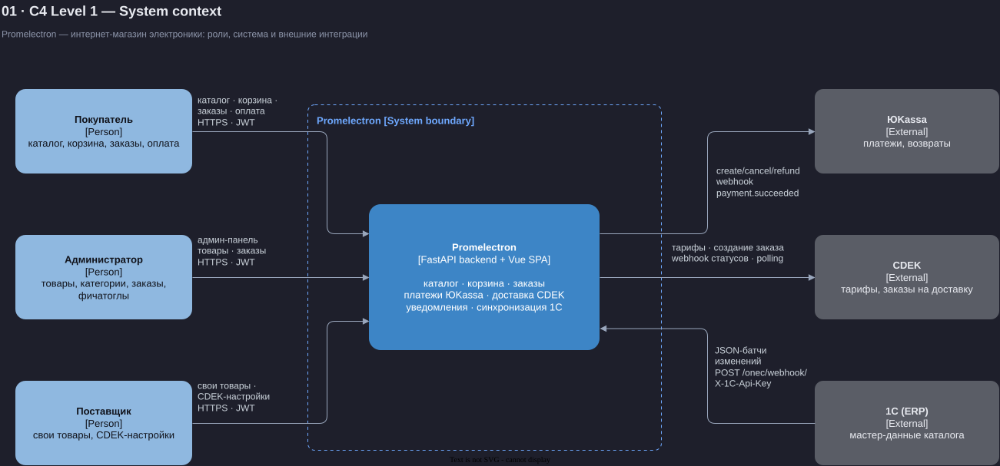
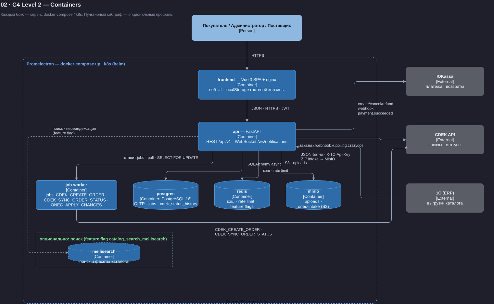

# Архитектура Promelectron — C4-диаграммы

Сквозная нумерация документации — 01–08, от общего к частному: начинать с
**01** (system context) и **02** (containers) ниже, затем sequence-флоу
**03–07** в [`docs/flows/`](../flows/README.md) и **08** — пайплайн агентов
([`docs/08-ai-agent-pipeline.svg`](../08-ai-agent-pipeline.svg)).

Исходники — drawio (`*.drawio`), рендер — SVG. Обе диаграммы генерируются
скриптом `scripts/docs/gen_diagrams.py` (см. инструкцию регенерации в
[`docs/flows/README.md`](../flows/README.md)).

## 01 · C4 Level 1 — System context — [01-c4-system-context.svg](01-c4-system-context.svg)

Три роли взаимодействуют с системой через веб-UI (HTTPS · JWT): **Покупатель**
(каталог, корзина, заказы, оплата), **Администратор** (товары, категории, заказы,
фичатоглы) и **Поставщик** (свои товары, CDEK-настройки). Система Promelectron —
монолит: FastAPI backend + Vue SPA. Внешние интеграции: **ЮKassa** (платежи,
возвраты, webhook `payment.succeeded`), **CDEK** (тарифы, заказы на доставку,
webhook статусов + polling) и **1С (ERP)** как мастер-данные каталога (JSON-батчи
изменений на `POST /api/v1/onec/webhook/` с заголовком `X-1C-Api-Key`).

## 02 · C4 Level 2 — Containers — [02-c4-containers.svg](02-c4-containers.svg)

Каждый бокс — сервис docker-compose / k8s (helm). Основной контур: `frontend`
(Vue 3 SPA + nginx) → `api` (FastAPI, REST `/api/v1` + WebSocket
`/ws/notifications`) → `postgres` (OLTP, таблица `jobs`, `cdek_status_history`),
`redis` (кэш, rate limit, feature flags), `minio` (uploads, `onec-intake`).
Фоновая обработка — `job-worker` (бесконечный цикл по таблице `jobs`:
`CDEK_CREATE_ORDER`, `CDEK_SYNC_ORDER_STATUS`, `ONEC_APPLY_CHANGES`). Пунктирный
сабграф — опциональный профиль поиска: `meilisearch` включается feature flag
`catalog_search_meilisearch`.

**Критичное свойство:** все внешние вызовы (ЮKassa, CDEK, 1С) идут только из
`api` и `job-worker`; хранилища не торчат наружу. Состояние заказов меняется
только под `SELECT FOR UPDATE`, а фоновые задачи доставки/1С идемпотентны —
повторный прогон job безопасен.
