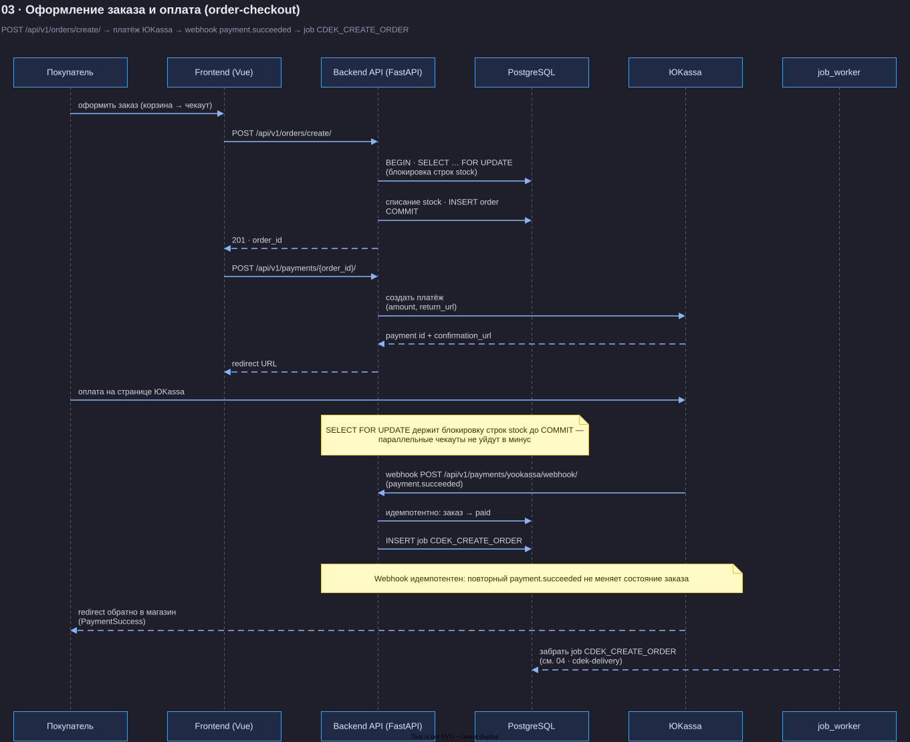
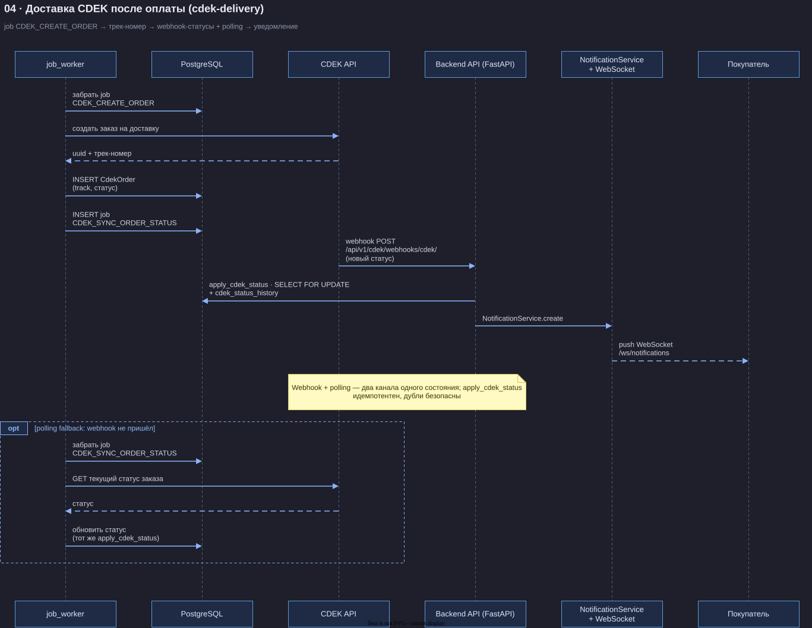
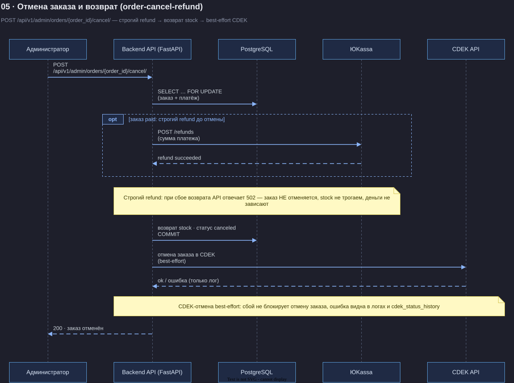
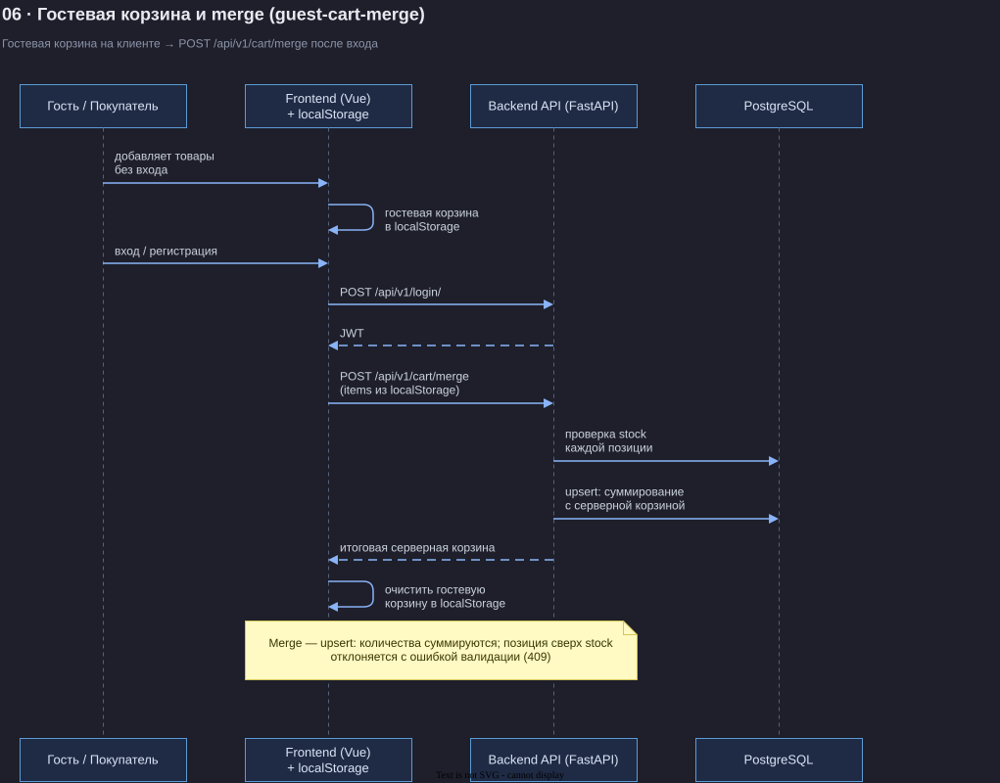
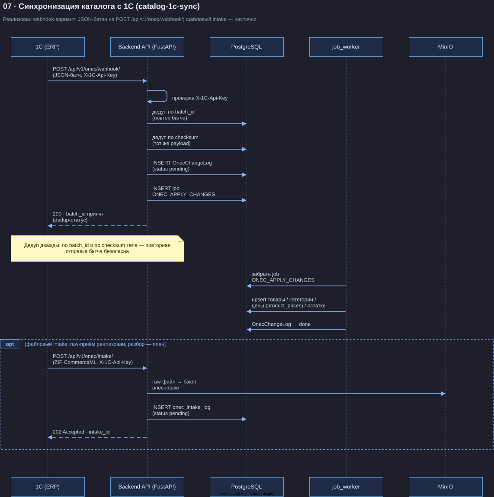

# Диаграммы последовательности бизнес-флоу Promelectron

Сквозная нумерация документации — 01–08, от общего к частному:
**01** и **02** — C4-диаграммы в [`docs/architecture/`](../architecture/README.md),
**03–07** — sequence-флоу ниже, **08** — пайплайн агентов
([`docs/08-ai-agent-pipeline.svg`](../08-ai-agent-pipeline.svg)).

Исходники — drawio (`*.drawio`, коммитятся в репо), рендер — SVG (`*.svg`).
Все диаграммы генерируются из декларативных описаний в едином тёмном стиле
(C4/sequence, ортогональные стрелки, sticky-notes, opt-фреймы).

Регенерация:

```bash
# из корня репозитория
python scripts/docs/gen_diagrams.py            # .drawio
python scripts/docs/gen_diagrams.py --render   # .drawio + .svg (drawio из $DRAWIO или ~/tools/drawio)

# или вручную для одного файла:
~/tools/drawio -x -f svg -o docs/flows/03-order-checkout.svg docs/flows/03-order-checkout.drawio
```

## Диаграммы

### 03 · Оформление заказа и оплата — [03-order-checkout.svg](03-order-checkout.svg)



`POST /api/v1/orders/create/` (проверка stock через `SELECT FOR UPDATE`, списание) →
`POST /api/v1/payments/{order_id}/` → создание платежа в ЮKassa → redirect на оплату →
webhook `payment.succeeded` на `/api/v1/payments/yookassa/webhook/` → заказ `paid`,
ставится job `CDEK_CREATE_ORDER`.

**Критичное свойство:** `SELECT FOR UPDATE` держит блокировку строк stock до `COMMIT` —
параллельные чекауты не могут увести остатки в минус. Webhook ЮKassa идемпотентен:
повторный `payment.succeeded` не меняет состояние заказа.

### 04 · Доставка CDEK — [04-cdek-delivery.svg](04-cdek-delivery.svg)



Job `CDEK_CREATE_ORDER` → создание заказа в CDEK API → трек-номер → webhook-статусы
(`POST /api/v1/cdek/webhooks/cdek/`) + polling через job `CDEK_SYNC_ORDER_STATUS` →
обновление статуса заказа → уведомление покупателя (NotificationService + WebSocket
`/ws/notifications`).

**Критичное свойство:** webhook и polling — два канала одного состояния;
`apply_cdek_status` вызывается под `SELECT FOR UPDATE` и идемпотентен, поэтому дубли
статусов (webhook + polling одновременно) безопасны.

### 05 · Отмена заказа и возврат — [05-order-cancel-refund.svg](05-order-cancel-refund.svg)



`POST /api/v1/admin/orders/{order_id}/cancel/`: строгий refund в ЮKassa для оплаченных
(при сбое — 502, заказ не отменяется) → возврат stock → best-effort отмена в CDEK.
Альтернатива: отмена неоплаченного платежа пользователем
(`POST /api/v1/payments/{payment_id}/cancel/`).

**Критичное свойство:** refund строгий — деньги возвращаются до отмены заказа; при сбое
возврата API отвечает 502, и ни статус заказа, ни stock не меняются. Отмена в CDEK —
best-effort: её сбой не блокирует отмену и виден только в логах.

### 06 · Гостевая корзина и merge — [06-guest-cart-merge.svg](06-guest-cart-merge.svg)



Гостевая корзина живёт на клиенте (localStorage) и сливается в серверную после входа:
`POST /api/v1/cart/merge` (проверка stock, суммирование количеств).

**Критичное свойство:** merge — это upsert: количества суммируются с серверной корзиной,
а позиция сверх доступного stock отклоняется с ошибкой валидации — «тихого» перепродажи
нет.

### 07 · Синхронизация каталога с 1С — [07-catalog-1c-sync.svg](07-catalog-1c-sync.svg)



Реализован webhook-вариант: 1С шлёт JSON-батчи изменений на `POST /api/v1/onec/webhook/`
(проверка `X-1C-Api-Key`, дедуп по batch_id/checksum, `OnecChangeLog` + job
`ONEC_APPLY_CHANGES`). Пунктирный `opt`-фрейм — файловый intake
(`POST /api/v1/onec/intake/`): raw-приём в MinIO (`onec-intake`) и `onec_intake_log`
уже реализованы, разбор файла — план.

**Критичное свойство:** дедупликация дважды — по `batch_id` и по checksum тела батча —
повторная отправка одного и того же батча безопасна и не применяет изменения дважды.

## Замечания

- Meilisearch подключён за feature flag `catalog_search_meilisearch` (сервис
  `search_service.py`, Phase 5, issue #121); до включения флага поиск работает
  SQL-запросами (`GET /api/v1/products/`).
- Файловый intake 1С: endpoint `POST /api/v1/onec/intake/` существует и сохраняет
  raw-файлы в MinIO (`onec-intake`) с записью в `onec_intake_log` (лимит 100 МБ, 202,
  #118); полный разбор файла в каталог — план.
